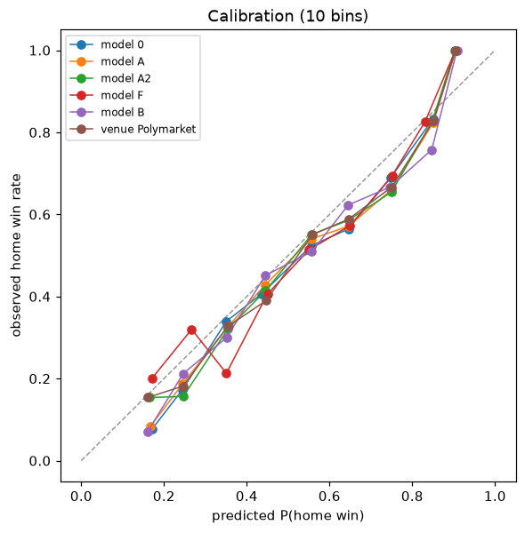

# Evaluation (pre-holdout) — pregame

Generated 2026-11-18 21:20 UTC. Rows: 7167.

## 1. Coverage

| season | rows | kalshi | poly |
|---|---|---|---|
| 2000 | 259 | 0 | 0 |
| 2001 | 259 | 0 | 0 |
| 2002 | 267 | 0 | 0 |
| 2003 | 267 | 0 | 0 |
| 2004 | 267 | 0 | 0 |
| 2005 | 267 | 0 | 0 |
| 2006 | 267 | 0 | 0 |
| 2007 | 267 | 0 | 0 |
| 2008 | 267 | 0 | 0 |
| 2009 | 267 | 0 | 0 |
| 2010 | 267 | 0 | 0 |
| 2011 | 267 | 0 | 0 |
| 2012 | 267 | 0 | 0 |
| 2013 | 267 | 0 | 0 |
| 2014 | 267 | 0 | 0 |
| 2015 | 267 | 0 | 0 |
| 2016 | 267 | 0 | 0 |
| 2017 | 267 | 0 | 0 |
| 2018 | 267 | 0 | 0 |
| 2019 | 267 | 0 | 0 |
| 2020 | 269 | 0 | 0 |
| 2021 | 285 | 0 | 0 |
| 2022 | 284 | 0 | 0 |
| 2023 | 285 | 0 | 0 |
| 2024 | 285 | 0 | 0 |
| 2025 | 285 | 285 | 285 |
| 2026 | 150 | 150 | 150 |

Polymarket feature resolution:

| season | poly_source | poly_resolution_sec | len |
|---|---|---|---|
| 2025 | history | 10800 | 285 |
| 2026 | history | 60 | 14 |
| 2026 | history | 300 | 119 |
| 2026 | history | 1800 | 17 |

Scoring set N = **370**. Drops (in order):

| filter | dropped |
|---|---|
| tie or unplayed | 16 |
| no Kalshi price (A) | 6718 |
| no line (Model 0) | 0 |
| no F | 0 |
| no B (burn-in, no Polymarket, or missing input) | 63 |

## 2. Primary — closing-line value

d = logit(model) − logit(kalshi_mid); Δ = logit(close) − logit(kalshi_mid). Positive slope / mean(sign(d)·Δ) means the close moved toward the model.

| close | model | n | slope | slope_lo | slope_hi | mean_sign_d_x_dk | mean_lo | mean_hi | verdict |
|---|---|---|---|---|---|---|---|---|---|
| Kalshi close | F | 435 | 0.0102 | -0.0019 | 0.0224 | 0.0024 | -0.0022 | 0.0069 | inconclusive |
| Kalshi close | B | 371 | -0.0488 | -0.1079 | 0.0063 | -0.0041 | -0.0093 | 0.0009 | inconclusive |
| Kalshi close | A2 | 435 | -0.1126 | -0.2717 | 0.0437 | -0.0009 | -0.0049 | 0.0031 | inconclusive |

## 3. Primary — lead-lag

gap_logit = logit(kalshi_mid) − logit(poly_mid); Δk, Δp regressed on it (bootstrap 95% CIs). Kalshi following Polymarket shows as Δk slope → −1; Polymarket following Kalshi as Δp slope → +1.

| stratum | target | n | slope | ci_lo | ci_hi |
|---|---|---|---|---|---|
| all | dk | 435 | 0.0563 | -0.0219 | 0.1359 |
| all | dp | 435 | 0.1524 | 0.0129 | 0.3189 |
| poly_res<=300s | dk | 133 | -0.7796 | -1.1175 | -0.5260 |
| poly_res<=300s | dp | 133 | 0.1570 | -1.7313 | 2.2454 |
| poly_res>=1800s | dk | 302 | 0.0991 | 0.0194 | 0.1794 |
| poly_res>=1800s | dp | 302 | 0.1775 | 0.0707 | 0.3065 |

## 4. Secondary — scoring on the scoring set

| model | n | log_loss | brier | accuracy |
|---|---|---|---|---|
| 0 | 370 | 0.6158 | 0.2141 | 0.6595 |
| A | 370 | 0.6179 | 0.2149 | 0.6568 |
| A2 | 370 | 0.6179 | 0.2149 | 0.6649 |
| F | 370 | 0.6436 | 0.2264 | 0.6351 |
| B | 370 | 0.6211 | 0.2160 | 0.6595 |

Paired bootstrap (2000 resamples):

| comparison | n | mean | ci_lo | ci_hi | mde_80pct | verdict |
|---|---|---|---|---|---|---|
| Brier(B) − Brier(A) | 370 | 0.0011 | -0.0008 | 0.0030 | 0.0028 | inconclusive |
| Brier(A2) − Brier(A) | 370 | -0.0000 | -0.0007 | 0.0006 | 0.0009 | inconclusive |

## 5. Calibration

  (model A = Kalshi venue)

## 6. Favorite–longshot (Kalshi price at predict_time)

| favorite_price | n | win_rate | wilson_lo | wilson_hi |
|---|---|---|---|---|
| 50%–60% | 127 | 0.5512 | 0.4644 | 0.6349 |
| 60%–70% | 152 | 0.6316 | 0.5525 | 0.7041 |
| 70%–80% | 101 | 0.7327 | 0.6390 | 0.8093 |
| 80%–90% | 50 | 0.8600 | 0.7381 | 0.9305 |
| 90%–100% | 3 | 1.0000 | 0.4385 | 1.0000 |

## 7. Disagreement buckets (|Kalshi − Polymarket|, probability points)

| gap_pts | n | kalshi_brier | kalshi_lo | kalshi_hi | poly_brier | poly_lo | poly_hi |
|---|---|---|---|---|---|---|---|
| [-inf, 1) | 267 | 0.2086 | 0.1892 | 0.2291 | 0.2084 | 0.1888 | 0.2286 |
| [1, 3) | 148 | 0.2099 | 0.1832 | 0.2382 | 0.2107 | 0.1840 | 0.2390 |
| [3, inf) | 18 | 0.2768 | 0.1940 | 0.3694 | 0.2729 | 0.1890 | 0.3706 |

## 8. Caveats

- Model 0's lines (nflverse `line_*`) name no book and no capture time; they may include news after predict_time.
- 2025 Polymarket features are ≥3-hour resolution (fine-grained history had expired before archiving began).
- Paper research only; small samples — read every CI before any point estimate.
