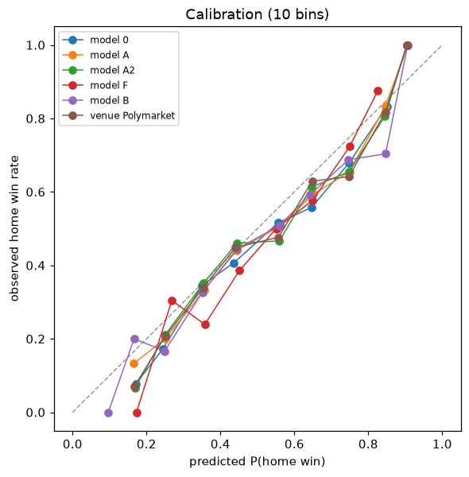

# Evaluation (pre-holdout) — tuesday

Generated 2026-11-18 21:20 UTC. Rows: 7169.

## 1. Coverage

| season | rows | kalshi | poly |
|---|---|---|---|
| 2000 | 259 | 0 | 0 |
| 2001 | 259 | 0 | 0 |
| 2002 | 267 | 0 | 0 |
| 2003 | 267 | 0 | 0 |
| 2004 | 267 | 0 | 0 |
| 2005 | 267 | 0 | 0 |
| 2006 | 267 | 0 | 0 |
| 2007 | 267 | 0 | 0 |
| 2008 | 267 | 0 | 0 |
| 2009 | 267 | 0 | 0 |
| 2010 | 265 | 0 | 0 |
| 2011 | 267 | 0 | 0 |
| 2012 | 267 | 0 | 0 |
| 2013 | 267 | 0 | 0 |
| 2014 | 267 | 0 | 0 |
| 2015 | 267 | 0 | 0 |
| 2016 | 267 | 0 | 0 |
| 2017 | 267 | 0 | 0 |
| 2018 | 267 | 0 | 0 |
| 2019 | 267 | 0 | 0 |
| 2020 | 264 | 0 | 0 |
| 2021 | 281 | 0 | 0 |
| 2022 | 284 | 0 | 0 |
| 2023 | 285 | 0 | 0 |
| 2024 | 285 | 0 | 0 |
| 2025 | 285 | 285 | 278 |
| 2026 | 163 | 150 | 163 |

Polymarket feature resolution:

| season | poly_source | poly_resolution_sec | len |
|---|---|---|---|
| 2025 | history | 10800 | 278 |
| 2026 | history | 60 | 27 |
| 2026 | history | 300 | 104 |
| 2026 | history | 1800 | 32 |

Scoring set N = **365**. Drops (in order):

| filter | dropped |
|---|---|
| tie or unplayed | 29 |
| no Kalshi price (A) | 6707 |
| no line (Model 0) | 0 |
| no F | 0 |
| no B (burn-in, no Polymarket, or missing input) | 68 |

## 2. Primary — closing-line value

d = logit(model) − logit(kalshi_mid); Δ = logit(close) − logit(kalshi_mid). Positive slope / mean(sign(d)·Δ) means the close moved toward the model.

| close | model | n | slope | slope_lo | slope_hi | mean_sign_d_x_dk | mean_lo | mean_hi | verdict |
|---|---|---|---|---|---|---|---|---|---|
| Kalshi close | F | 435 | 0.0560 | 0.0230 | 0.0892 | 0.0286 | 0.0112 | 0.0463 | higher |
| Kalshi close | B | 366 | -0.0975 | -0.3577 | 0.1449 | -0.0057 | -0.0249 | 0.0138 | inconclusive |
| Kalshi close | A2 | 435 | -0.0525 | -1.1518 | 0.1714 | -0.0156 | -0.0328 | 0.0006 | inconclusive |
| line (alt. close) | F | 435 | 0.0571 | 0.0235 | 0.0942 | 0.0257 | 0.0101 | 0.0423 | higher |
| line (alt. close) | B | 366 | -0.1385 | -0.3843 | 0.1081 | -0.0065 | -0.0244 | 0.0119 | inconclusive |
| line (alt. close) | A2 | 435 | -0.0861 | -1.1417 | 0.1420 | -0.0172 | -0.0332 | -0.0023 | lower |

## 3. Primary — lead-lag

gap_logit = logit(kalshi_mid) − logit(poly_mid); Δk, Δp regressed on it (bootstrap 95% CIs). Kalshi following Polymarket shows as Δk slope → −1; Polymarket following Kalshi as Δp slope → +1.

| stratum | target | n | slope | ci_lo | ci_hi |
|---|---|---|---|---|---|
| all | dk | 428 | 0.0262 | -0.0913 | 0.5606 |
| all | dp | 428 | 1.1191 | 0.9406 | 1.4265 |
| poly_res<=300s | dk | 118 | 0.4327 | -0.8237 | 1.6391 |
| poly_res<=300s | dp | 118 | 1.7739 | 0.3665 | 3.3571 |
| poly_res>=1800s | dk | 310 | 0.0115 | -0.1086 | 0.5902 |
| poly_res>=1800s | dp | 310 | 1.1050 | 0.9275 | 1.4223 |

## 4. Secondary — scoring on the scoring set

| model | n | log_loss | brier | accuracy |
|---|---|---|---|---|
| 0 | 365 | 0.6184 | 0.2153 | 0.6548 |
| A | 365 | 0.6263 | 0.2188 | 0.6411 |
| A2 | 365 | 0.6256 | 0.2187 | 0.6411 |
| F | 365 | 0.6432 | 0.2264 | 0.6329 |
| B | 365 | 0.6313 | 0.2207 | 0.6493 |

Paired bootstrap (2000 resamples):

| comparison | n | mean | ci_lo | ci_hi | mde_80pct | verdict |
|---|---|---|---|---|---|---|
| Brier(B) − Brier(A) | 365 | 0.0019 | -0.0001 | 0.0041 | 0.0030 | inconclusive |
| Brier(A2) − Brier(A) | 365 | -0.0002 | -0.0017 | 0.0008 | 0.0018 | inconclusive |

## 5. Calibration

  (model A = Kalshi venue)

## 6. Favorite–longshot (Kalshi price at predict_time)

| favorite_price | n | win_rate | wilson_lo | wilson_hi |
|---|---|---|---|---|
| 50%–60% | 141 | 0.5319 | 0.4498 | 0.6123 |
| 60%–70% | 130 | 0.6462 | 0.5608 | 0.7231 |
| 70%–80% | 110 | 0.7364 | 0.6471 | 0.8097 |
| 80%–90% | 49 | 0.8571 | 0.7333 | 0.9290 |
| 90%–100% | 3 | 1.0000 | 0.4385 | 1.0000 |

## 7. Disagreement buckets (|Kalshi − Polymarket|, probability points)

| gap_pts | n | kalshi_brier | kalshi_lo | kalshi_hi | poly_brier | poly_lo | poly_hi |
|---|---|---|---|---|---|---|---|
| [-inf, 1) | 290 | 0.2095 | 0.1897 | 0.2291 | 0.2094 | 0.1895 | 0.2291 |
| [1, 3) | 127 | 0.2199 | 0.1921 | 0.2477 | 0.2219 | 0.1939 | 0.2505 |
| [3, inf) | 9 | 0.3324 | 0.2413 | 0.4393 | 0.3076 | 0.2519 | 0.3674 |

## 8. Caveats

- Model 0's lines (nflverse `line_*`) name no book and no capture time; they may include news after predict_time.
- 2025 Polymarket features are ≥3-hour resolution (fine-grained history had expired before archiving began).
- Paper research only; small samples — read every CI before any point estimate.
